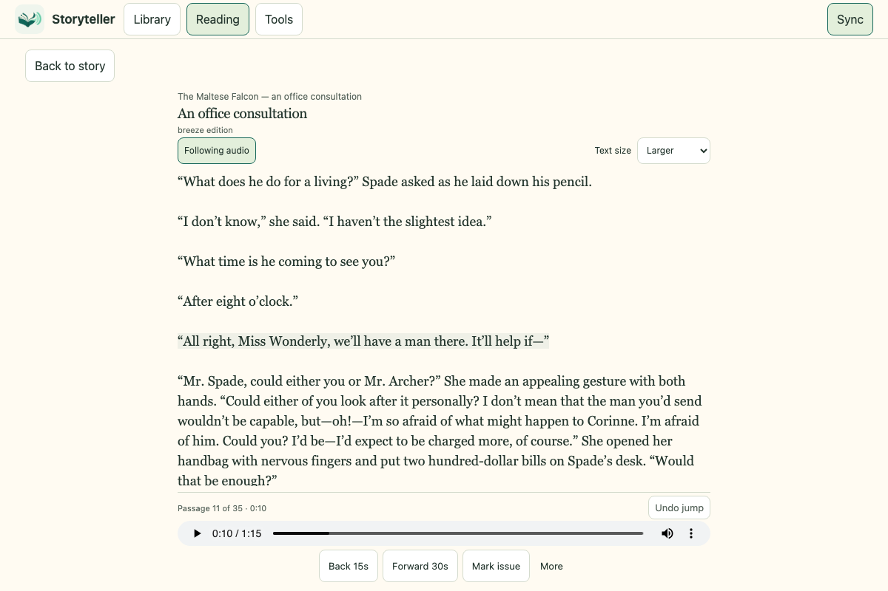
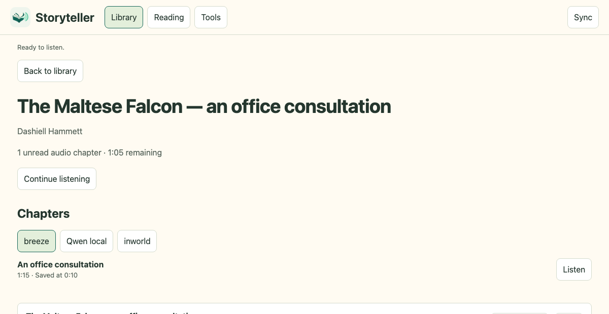
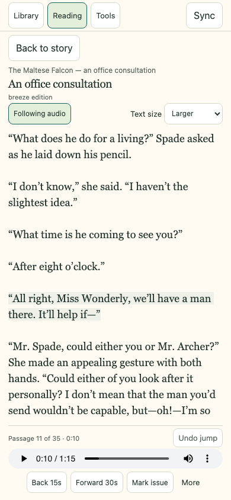

# Storyteller


Turn stories into audiobooks with a voice for every character. Generate with
Breeze, Qwen, Inworld, or ElevenLabs, then listen on the web or Android with
read-along text and synced progress.

**[Listen to Storyteller](https://benbernard.github.io/storyteller/#listen)** ·
[Get started](#start-here-run-storyteller) · [Setup guides](#choose-a-generation-path)

## Hear it for yourself

A narrator, Sam Spade, Miss Wonderly, and Miles Archer in a short scene from
*The Maltese Falcon*. Compare the same dialogue in three editions, right in your
browser.

| Edition | Play | Length |
| --- | --- | --- |
| **Breeze** · recommended local renderer | **[Listen to Breeze](https://benbernard.github.io/storyteller/?edition=breeze#listen)** | 1:16 |
| **Qwen** · local alternative | **[Listen to Qwen](https://benbernard.github.io/storyteller/?edition=qwen#listen)** | 1:16 |
| **Inworld** · speech API | **[Listen to Inworld](https://benbernard.github.io/storyteller/?edition=inworld#listen)** | 1:25 |

The [demo page](https://benbernard.github.io/storyteller/#listen) has audio players
and passage seeking. No account or installation needed. See the
[transcript, MP3 downloads, and recording notes](samples/maltese-falcon/README.md).

## Inside Storyteller

Follow the highlighted passage as you listen, or choose one to jump to that part
of the recording.



Choose an edition from the book's chapter screen. Each recording keeps its own
timings and saved position.



<details>
<summary>See the mobile reader</summary>



The [Android app](docs/android.md) also supports checked offline downloads.

</details>

## Features

- Downloads Royal Road chapters into a resumable archive and exports EPUBs.
  Also imports EPUB, selectable-text PDF, TXT, or chapter JSON.
- Tracks the exact source text, dialogue, character identities, casting decisions,
  and recording timelines.
- Generates speech locally with Breeze or Qwen, or through Inworld and ElevenLabs,
  with cached requests, resumable batches, and selective repairs.
- Offers synthetic voice design, acting directions, and transcript/phoneme review
  for Breeze. Qwen supports automatic chapter follows and listening buffers.
- Plays separate editions with passage seeking, playback speed, progress history,
  issue reports, and Android offline downloads.

## Start here: run Storyteller

You need Git, Node.js 22.13 or newer, and Docker with Compose v2. On macOS or
Windows, start Docker Desktop first. These commands use a POSIX shell; on Windows,
use WSL2.

```sh
git clone https://github.com/benbernard/storyteller.git
cd storyteller
node scripts/setup.mjs
docker compose build listener
docker compose run --rm sample
docker compose up -d --wait listener
```

Open **<http://localhost:8080/listen/>**. Sign in as `listener` with the password in
`data/credentials/listener-password`. Open *The Maltese Falcon* and switch editions
to compare them.

The sample is bundled, so you can try the reader before setting up a speech
engine. `setup.mjs` creates private state directories and a random password,
preserving existing files. For more hosting options, see [Operations](docs/operations.md).

## Choose a generation path

| Goal | Guide | What you need |
| --- | --- | --- |
| Import chapters or your own book | [Importing](docs/importing.md) | Source text you may use |
| Generate speech on your Mac (recommended) | [Breeze setup](docs/breeze.md) | Apple Silicon Mac, model storage, Codex subscription |
| Use the Inworld API | [Inworld setup](docs/inworld.md) | Inworld voices/key, analysis, explicit budgets |
| Use ElevenLabs | [Paid generation](docs/paid-generation.md) | ElevenLabs and OpenAI API keys, explicit budgets |
| Use Qwen and automatic follows | [Qwen setup](docs/local-generation.md) | Apple Silicon Mac, model storage, analysis account |
| Listen on a phone | [Android](docs/android.md) | Android 13+, your server over HTTPS |
| Run a persistent server or restore a backup | [Operations](docs/operations.md) | Docker host and your own HTTPS endpoint |
| Develop or contribute | [Development](docs/development.md) | Pinned pnpm, FFmpeg, optional Android tools |

Local speech runs on an Apple Silicon Mac. Speaker analysis uses your configured
Codex subscription or an explicitly enabled OpenAI API workflow. Start with one
chapter and audition your cast before generating a book.

## Where things live

```text
tools/audiobooks/           Engine, listener, worker, tests, examples
tools/royal-road/           Downloader and EPUB exporter
tools/mac-tts/              Mac speech API, model locks, local renderer
android/audiobook-listener/ Android client
site/                      Public demo and getting-started page
samples/maltese-falcon/     Bundled audio, transcript, and provenance
scripts/                   Setup, generation, and demo tools
data/                      Your private state (ignored by Git)
```

Back up the whole `data/` directory to keep your books, casting, and listening
progress together.

## License

[PolyForm Noncommercial 1.0.0](LICENSE). Dependencies, model weights, and speech
providers have their own terms. See [third-party notices](THIRD_PARTY.md).
The sample's [source and rights notes](samples/maltese-falcon/README.md#source-and-rights)
credit the 1930 text and the new synthetic recordings.

Running a private deployment or preserving an existing Android installation? See [integration contracts and composition](docs/integrations.md).
